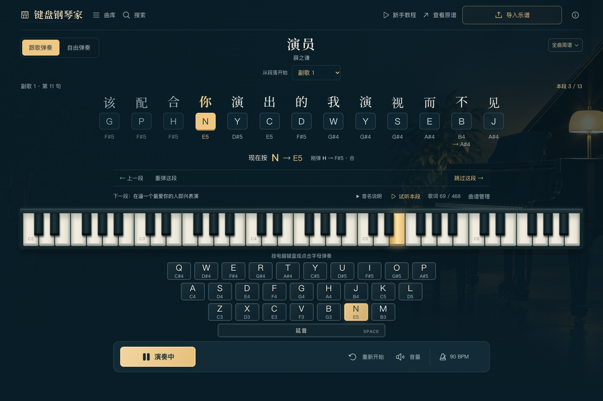
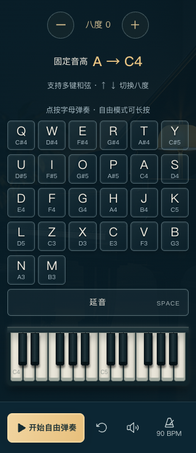

# 键盘钢琴家

## 弹钢琴，何必需要一台钢琴。

把熟悉的电脑键盘，变成你的第一间琴房。

**键盘钢琴家**是一款打开网页就能玩的钢琴小产品。选一首喜欢的歌，跟着歌词下方的字母提示敲键盘，就能弹出对应旋律。也可以切换到自由弹奏，让每一次敲击都发出琴声。

**[🎹 打开琴房，直接体验](https://keyboard-pianist.pages.dev/)** · [三步开始](#三步弹出第一段旋律) · [带上自己的乐谱](#把自己的乐谱带进琴房)

*上图为本仓库的「沉浸舞台」界面；在线体验入口目前保留此前发布的琴房界面。*

## 三步，弹出第一段旋律

1. **选一首歌。** 从曲库挑一首熟悉的旋律，第一次进入还有简短的新手教程。
2. **看提示，敲字母。** 切换到英文输入法，按下金色提示对应的字母；有歌词的部分通常对应这个字的拼音首字母。
3. **一句一句，慢慢弹。** 当前完整一句会一起展示，弹完后进入下一句。想再练一次，可以重弹；想先听听，可以试听本段。

同一个字母会随着歌曲进度，奏出当前应该弹的音。每个提示下方也标出了音名，方便边玩边认识音符。

## 你可以怎样玩

### 跟着喜欢的歌弹

完整一句歌词、字母和音名放在一起，当前该按的键用暖金色标出。前奏、间奏和尾奏按所选曲谱分成小段，跟着提示逐音弹奏。可以从指定段落开始，也可以重弹、跳过或试听。

想更轻松一点，可以试试「任意键演奏」：按任意字母，推进当前旋律。跟歌时按其他非提示字母，也能发声，不会打乱练习进度。

### 随手即兴，找自己的旋律

切换「自由弹奏」，26个字母就有了各自的音高。支持同时按多个键、按住发声、切换八度，以及用空格控制延音。屏幕上的字母键和钢琴键也可以直接点击。

### 电脑敲键盘，手机点着弹

电脑上保留熟悉的键盘排列，适合双手弹奏；手机上用更大的触摸按键，演奏控制放在底部。无须安装或注册，打开网页就能开始。

  

## 先从这些歌开始

目前内置 **12首歌曲 + 2首原创练习**：

| | | |
|---|---|---|
| 演员 · 薛之谦 | 成都 · 赵雷 | 告白气球 · 周杰伦 |
| 小幸运 · 田馥甄 | 后来 · 刘若英 | 十年 · 陈奕迅 |
| 好久不见 · 陈奕迅 | 往后余生 · 马良 | 追光者 · 岑宁儿 |
| 岁月神偷 · 不才版 | 纸短情长 · 烟把儿乐队 | 暖暖 · 梁静茹 |

歌曲按所选简谱版本整理，主要呈现旋律，不等同于原录音的全部伴奏。不同版本包含的器乐段可能不同，可在琴房的原谱与版本说明中查看。

曲库还能按中文、拼音和首字母搜索。在线原谱目录中的条目，会在导入、转换并保存后成为可弹歌曲。

## 把自己的乐谱带进琴房

点击「导入乐谱」，选好文件，试听并校对，就能保存到自己的曲库。

- **MusicXML、MXL、MIDI**：读取音符与时值；带歌词的文件可生成首字母提示。
- **PDF、PNG、JPG、WebP**：在浏览器里识谱，生成可试听、可修改的初稿。
- **曲谱 JSON**：把之前导出的曲谱备份重新带回来。

**识谱后先听一遍，再保存。** 扫描清晰度、复杂反复和歌词排版会影响结果，有时需要调整音符或歌词。没有歌词的曲谱也能按音符提示弹奏。

上传的乐谱在当前浏览器本机处理，个人曲库也保存在当前浏览器。换设备、换网址或清理浏览器数据时，记得先到「曲谱管理」导出备份。

## 几个小提示

- **没有声音？** 先点击一次页面或按下按键，再检查网页音量和设备音量。
- **跟不上？** 可以先试听本段、从熟悉的段落练起。默认练习速度为90 BPM，调速会影响试听和音符播放速度；手动敲键的间隔仍由你掌握。
- **不会看谱也能玩吗？** 可以，先跟着金色字母提示开始；自由弹奏则适合自己探索。
- **上传 PDF 就和内置歌曲一样准确吗？** 自动识谱会给出初稿，需要试听校对；复杂谱面可能需要较多调整。

## 一起把琴房做得更好

欢迎通过 [Issues](https://github.com/w88856678-rgb/keyboard-pianist/issues) 分享体验、反馈问题，或告诉我你想弹哪首歌。反馈时附上设备、浏览器和操作步骤，会更容易定位问题。

如果这个小琴房让你找回了一点弹奏的快乐，欢迎点一个 Star，或把体验链接分享给朋友。

想在自己的电脑上运行？见 [本地运行与部署](docs/getting-started.md)。曲谱版本见 [曲库与导入说明](docs/music-library.md)，第三方素材来源见 [来源与许可说明](THIRD_PARTY_NOTICES.md)。
